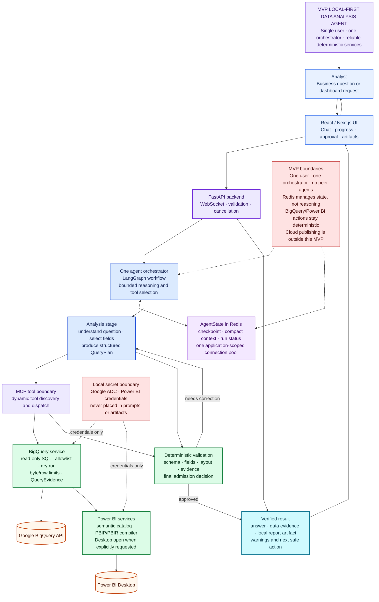

# MVP local-first data-analysis agent

This is the simplified architecture for the first reliable implementation. Read from top to bottom.

The MVP deliberately uses one orchestrating agent. BigQuery access, Power BI artifact generation, and validation remain deterministic services. Redis stores checkpoints and compact structured context; it is created through an application-scoped connection pool and dependency injection, not a global Singleton.

The cloud publishing and multi-user identity branches can be added after this local workflow is stable.
## Architecture decisions

### D1 — Local-first modular monolith

**Chosen:** one FastAPI backend containing the orchestration, data, Power BI, and validation modules.

**Why:** the MVP is for one user and local Power BI Desktop. This minimizes deployment and debugging overhead while keeping module boundaries clear.

**Deferred alternative:** microservices. They would add network contracts, deployment, observability, and failure modes before the workflow is stable.

### D2 — Clean/hexagonal boundaries

**Chosen:** the application depends on ports such as `ContextStore`, `LockService`, `EventPublisher`, and `BigQueryGateway`; Redis and cloud services are adapters.

**Why:** infrastructure can change without rewriting the agent core, and each service can be tested with fakes.

**Deferred alternative:** direct SDK calls throughout the agent. That would couple reasoning, credentials, vendor APIs, and persistence.

### D3 — One orchestrating agent

**Chosen:** one bounded agent with an analysis stage, followed by deterministic tool execution and validation.

**Why:** the MVP does not need peer-agent handoffs. One orchestrator is easier to trace, cheaper to run, and less likely to lose context.

**Deferred alternative:** separate extractor, executor, validator, and report-builder agents. Those may be introduced only when complexity or team ownership justifies them.

### D4 — Deterministic services have execution authority

**Chosen:** BigQuery security, Power BI compilation, and QA are implemented as code, not delegated to the LLM.

**Why:** allowlists, byte limits, schema checks, versioning, and approval rules must be reproducible and fail closed.

**Rejected alternative:** allowing the LLM to call provider SDKs directly. Prompts cannot be treated as a security boundary.

### D5 — Redis with an application-scoped pool

**Chosen:** Redis stores checkpoints, compact structured context, run status, locks, and typed events. The backend creates one pool during application startup and injects interfaces into services.

**Why:** state survives reconnects and restarts, and the same design can coordinate multiple workers later.

**Rejected alternative:** a global Singleton client. It hides lifecycle and configuration, complicates testing, and creates unsafe process-global state.

### D6 — Structured context compaction

**Chosen:** retain query plans, evidence summaries, dashboard specifications, validation findings, and artifact references; bound or discard verbose raw tool payloads.

**Why:** each workflow stage receives the smallest relevant context while durable evidence remains available for replay and audit.

**Deferred alternative:** unlimited transcript replay, which increases token cost and eventually exceeds model context windows.

### D7 — Local delivery first

**Chosen:** generate a credential-free semantic model/report artifact and open it in Power BI Desktop only when explicitly requested.

**Why:** this validates the core BigQuery-to-Power BI workflow without requiring Fabric administration or Entra application registration.

**Deferred alternative:** cloud-first publishing. It adds tenant permissions, capacity, identity, and long-running API operations before the local core is hardened.

## MVP success criterion

A single analyst can ask a question, receive evidence-backed results, optionally generate a validated local Power BI artifact, and resume the run after a reconnect—without peer-agent complexity or cloud administration.